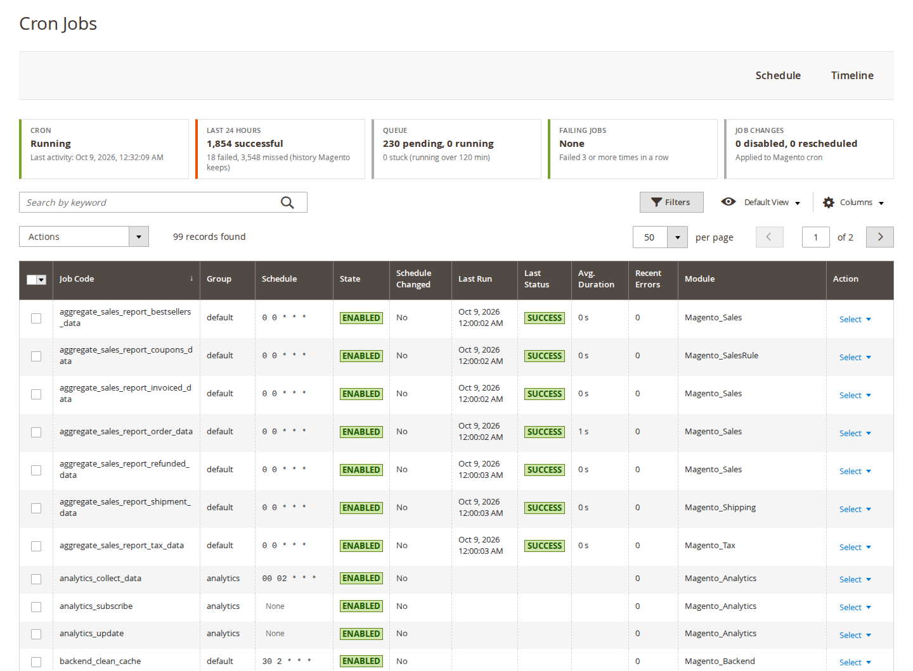
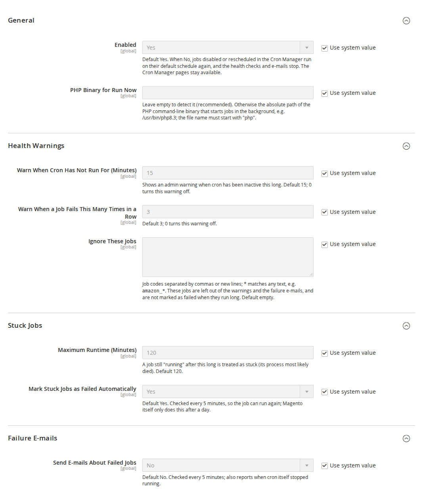
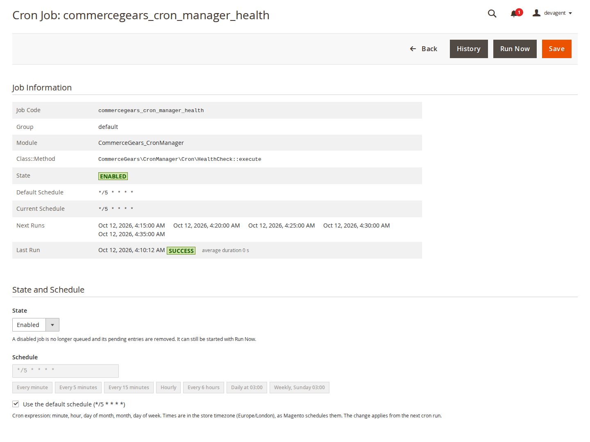
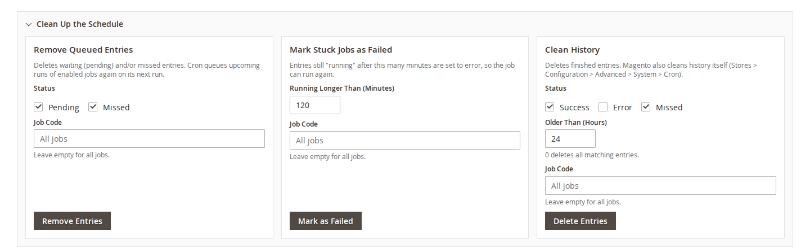
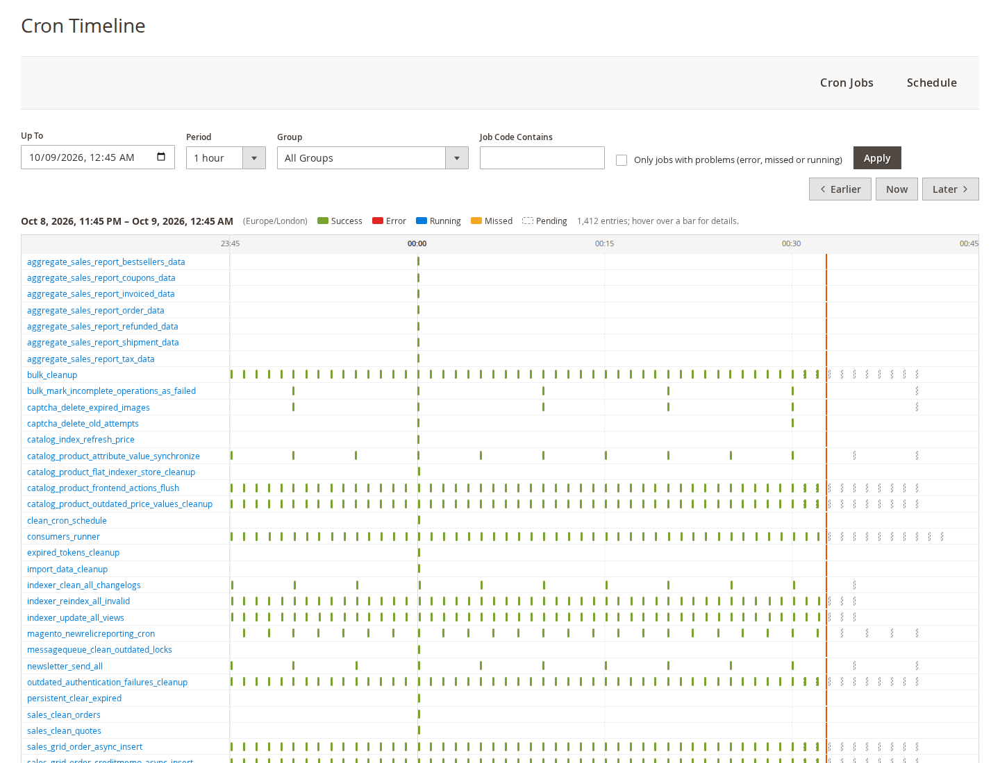

# Cron Manager for Magento 2: User Guide

See and control Magento's cron from the admin: every job with its schedule and run statistics, the cron schedule as a
grid and as a timeline, Run Now, enable, disable and reschedule jobs, clean up the queue, and get warned when cron
stops or a job keeps failing. This guide covers installation, configuration and day-to-day use.

- Admin demo: https://demo.softawarecommerce.com/try-admin/cron-manager
- Changelog: [CHANGELOG.md](../CHANGELOG.md) · Questions: [FAQ](faq.md)



## 1. Requirements

| | |
| --- | --- |
| Magento | Open Source or Adobe Commerce 2.4.7 to 2.4.9 |
| PHP | 8.2 to 8.5, with a PHP command-line binary for Run Now |
| Database | MySQL 8 or MariaDB 10.4 or later (window functions are used) |
| Storefront | None: the module is admin only |
| Other | `softaware/module-core` (installed automatically) |

Magento's cron must be set up on the server as usual (`bin/magento cron:install` or your own crontab entry). Cron
Manager works with Magento's cron; it does not replace it.

## 2. Installation

Install with Composer from repo.softawarecommerce.com. The access keys are in your account on
softawarecommerce.com; see [Composer access](https://softawarecommerce.com/shop/composer-access/) for details.

```bash
composer config repositories.softaware composer https://repo.softawarecommerce.com
composer config --auth http-basic.repo.softawarecommerce.com PUBLIC_KEY PRIVATE_KEY
composer require softaware/module-cron-manager
bin/magento setup:upgrade
bin/magento setup:di:compile            # production mode only
bin/magento setup:static-content:deploy # production mode only
bin/magento cache:flush
```

To update later: `composer update softaware/module-cron-manager`, then the same `bin/magento` commands.

After installation the admin menu has **Softaware > Cron Manager** with four items: **Cron Jobs**, **Schedule**,
**Timeline** and **Settings**.

## 3. Settings

**Stores > Configuration > Softaware > Cron Manager** (also **Softaware > Cron Manager > Settings**). All settings
are global (default scope). Every field states its default and has a "Use system value" checkbox to restore it.



### General

| Setting | What it does |
| --- | --- |
| Enabled | Default Yes. When No, jobs you disabled or rescheduled in the Cron Manager run on their default schedule again, and the health checks and e-mails stop. The pages stay available and your changes are kept. |
| PHP Binary for Run Now | Leave empty to detect it (recommended). Otherwise the absolute path of the PHP command-line binary, for example `/usr/bin/php8.3`. Only an absolute path to an executable whose file name starts with `php` is accepted. |

### Health Warnings

| Setting | What it does |
| --- | --- |
| Warn When Cron Has Not Run For (Minutes) | Shows an admin warning when cron has been inactive this long. Default 15; 0 turns the warning off; at most 10080 (one week). |
| Warn When a Job Fails This Many Times in a Row | Default 3; 0 turns the warning off; at most 1000. |
| Ignore These Jobs | Job codes separated by commas or new lines; `*` matches any text, for example `amazon_*`. These jobs are left out of the warnings, the status panel and the failure e-mails, and are not marked as failed when they run long. Default empty. |

### Stuck Jobs

| Setting | What it does |
| --- | --- |
| Maximum Runtime (Minutes) | A job still "running" after this long is treated as stuck (its process most likely died). Default 120; 1 to 10080 (one week). |
| Mark Stuck Jobs as Failed Automatically | Default Yes. Checked every 5 minutes, so the job can run again; Magento itself only does this after a day. |

### Failure E-mails

| Setting | What it does |
| --- | --- |
| Send E-mails About Failed Jobs | Default No. Checked every 5 minutes; also reports when cron itself stopped running. |
| Send To | One or more e-mail addresses, separated by commas. |
| Sender | The store e-mail identity the e-mails are sent from. Default General Contact. |
| E-mail Template | Default "Cron Manager: Failed Cron Jobs". Create your own under Marketing > Email Templates. |
| At Most One E-mail Every (Minutes) | Failures in between are collected into the next e-mail. Default 60; 1 to 10080 (one week). |

## 4. Cron Jobs

**Softaware > Cron Manager > Cron Jobs** lists every job Magento knows: the jobs from `crontab.xml` files and jobs
whose schedule comes from the configuration.

Columns: Job Code, Group, Schedule (the one in use), Default Schedule, State, Schedule Changed, Last Run, Last Status,
Avg. Duration, Recent Errors, Pending, Module, Class::Method and Last Message. Some columns are hidden by default; show
them with **Columns**. The grid has filters, keyword search, sorting and saved views. A job whose schedule was changed
in the Cron Manager is marked "Changed" in the Schedule column; hover over it to see the default. A disabled job shows
"Not queued (job disabled)" there. Filter by **State** (Enabled, Disabled) and **Last Status** (Success, Error, Missed,
Running, No recent runs). "No recent runs" means the job has no finished entry in the history Magento keeps, which is
short for successful runs by default.

**Row actions:** Edit, Run Now, Enable or Disable (whichever applies to the job's current state), History (the job's
entries in the Schedule grid). Run Now, Enable and Disable are sent as POST requests and ask for confirmation first.

**Mass actions:** Run Now (up to 20 jobs at a time), Enable, Disable, Restore Default Schedule.

### Status panel

Above the Cron Jobs and Schedule grids, a status panel shows:

- **Cron:** running, or how many minutes ago it was last active.
- **Last 24 Hours:** successful, failed and missed runs (within the history Magento keeps).
- **Queue:** pending and running entries, and how many are stuck.
- **Failing Jobs:** jobs that failed the set number of times in a row.
- **Job Changes:** how many jobs are disabled or rescheduled, and whether the changes are applied.

The figures are cached for 3 minutes so the admin stays fast.

## 5. Editing a job

Click **Edit** on a job. The page **Cron Job: <code>** shows the job information (group, module, class and method,
state, default and current schedule, the next runs in the store timezone, and the last run with its status and
average duration), and a form to change it.



- **State:** Enabled or Disabled. A disabled job keeps its definition but is no longer queued, and its pending entries
  are removed. It can still be started with Run Now.
- **Schedule:** a cron expression (minute, hour, day of month, month, day of week), checked with Magento's own cron
  parser. Presets: Every minute, Every 5 minutes, Every 15 minutes, Hourly, Every 6 hours, Daily at 03:00, Weekly,
  Sunday 03:00.
- **Use the default schedule:** removes your change for this job.

The buttons above the page are **Back**, **History**, **Run Now** (asks for confirmation) and **Save**. Changes apply
from the next cron run. They are stored in the configuration (`softaware_cron_manager/overrides/jobs`) and can be
exported with `bin/magento app:config:dump`. If that value is set in `app/etc/config.php` or `env.php`, the Cron
Manager shows the changes as read-only and refuses to change them.

## 6. Run Now

Run Now starts `bin/magento softaware:cron:run <job_code>` in the background, so the admin request does not wait
for the job. The run:

- takes the same lock as Magento's cron, so it does not start while the job is already running;
- is written to the cron schedule with status, start and finish time and a message such as "Ran manually (admin,
  <user>) in 0.4 s";
- is logged to `var/log/softaware_cron_manager.log`.

After a Run Now from the grid you are taken to the Schedule page, where the new entry appears.

## 7. Schedule

**Softaware > Cron Manager > Schedule** shows the `cron_schedule` table as a grid: keyword search (job code or
message), filters by job, status, dates and message, a duration column, coloured statuses and a mass delete action.

### Clean Up the Schedule

Open the **Clean Up the Schedule** panel above the grid. Each action asks for confirmation before it runs, and each
can be limited to one job code (leave the field empty for all jobs).



| Action | What it does |
| --- | --- |
| Remove Queued Entries | Deletes pending and/or missed entries. Cron queues upcoming runs of enabled jobs again on its next run. |
| Mark Stuck Jobs as Failed | Entries still "running" after the given number of minutes (a whole number, 1 or more) are set to error, so the job can run again. |
| Clean History | Deletes finished entries (success, error, missed) older than the given number of hours; 0 deletes all matching entries. |

## 8. Timeline

**Softaware > Cron Manager > Timeline** draws one row per job for a period of 1, 3, 6, 12 or 24 hours. Bars are
coloured by status (success, error, running, missed, pending), a line marks the current time, and hovering over a bar
shows its details. With the keyboard, tab into the chart and move between bars with the arrow keys (Home and End jump
to the first and last bar of a row); the details of the focused bar appear below the chart. Filter by group, by job code or to "Only jobs with problems (error, missed or running)", and move
with **Earlier**, **Now** and **Later**.



The timeline and the statistics only cover the history Magento keeps (Stores > Configuration > Advanced > System >
Cron). Successful runs are kept for a short time by default.

## 9. Warnings and e-mails

**Admin messages** appear in Magento's system messages when:

- cron has not run for the set number of minutes (or has never run);
- a job failed the set number of times in a row;
- a job has been running longer than the maximum runtime.

**Failure e-mails** (off by default) are sent by the cron job `softaware_cron_manager_health`, which runs every 5
minutes. It e-mails new failures at most once per interval, collecting failures in between, and reports gaps when cron
itself did not run. Gaps are measured in the cron history of the last hour, so rescheduling the health job does not
cause false alarms. The same job marks stuck jobs as failed when that setting is on.

## 10. Command line

```bash
bin/magento softaware:cron:list [--group=<group>] [--search=<text>] [--disabled] [--overridden] [--failed]
bin/magento softaware:cron:run <job_code> [--trigger=cli] [--user=<name>]
bin/magento softaware:cron:status
bin/magento softaware:cron:set <job_code> [<job_code> ...] [--enable|--disable] [--schedule="*/15 * * * *"]
bin/magento softaware:cron:set <job_code> [<job_code> ...] --default
```

- `list`: all jobs with schedule, state, last run and average duration.
- `run`: runs a job now in the foreground (also disabled jobs); the run is recorded in the cron schedule.
- `status`: last activity, failing and stuck jobs, counts, disabled and rescheduled jobs.
- `set`: makes the same changes as the Cron Jobs page, useful in deployment scripts. `--default` removes all changes
  of the jobs.

## 11. Permissions (ACL)

Under **System > Permissions > User Roles > Role Resources > Softaware > Cron Manager**:

| Resource | Allows |
| --- | --- |
| View Cron Jobs | The Cron Jobs grid |
| Run Jobs Now | Run Now (single and mass action) |
| Enable, Disable and Reschedule Jobs | The job page and its changes, Enable, Disable, Restore Default Schedule |
| View Schedule and Timeline | The Schedule and Timeline pages |
| Clean Up Schedule | The clean-up tools and mass delete on the Schedule page |
| Cron Manager Settings | The configuration section |

## 12. Troubleshooting

| Problem | Solution |
| --- | --- |
| "Cron has not run for N minutes" | Check the server crontab (`crontab -l` for the web server user) and that `bin/magento cron:run` works. The message goes away once cron runs again. |
| Run Now does nothing | The PHP binary was not found, or the server does not allow starting processes. Set **PHP Binary for Run Now** to the absolute path of the PHP CLI binary and check `var/log/softaware_cron_manager.log`. |
| "Not started: the job is already running" | The job holds Magento's cron lock. Wait for it to finish, or mark it as failed if it is stuck. |
| My schedule change has no effect | Check that **Enabled** is Yes, and whether the status panel says "Read-only": the changes are then set in `app/etc/config.php` or `env.php` and must be changed there. |
| The timeline or statistics look empty | They only cover the history Magento keeps. Raise the history lifetimes under Stores > Configuration > Advanced > System > Cron if you need more. |
| Too many warnings from one extension | Add its job codes, or a pattern such as `vendor_*`, to **Ignore These Jobs**. |
| The e-mail is only sent after cron is back | Expected: e-mails are sent by cron. The admin warning covers the time cron is down. |

## 13. Uninstall

```bash
bin/magento module:disable Softaware_CronManager
composer remove softaware/module-cron-manager
bin/magento setup:upgrade
```

Once the module is removed, all jobs run on their default schedule again. The settings and stored job changes stay in
the `core_config_data` table (paths starting with `softaware_cron_manager/`); delete those rows if you want a clean
database.
